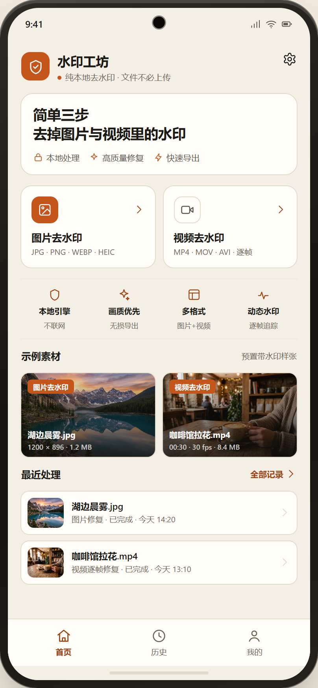
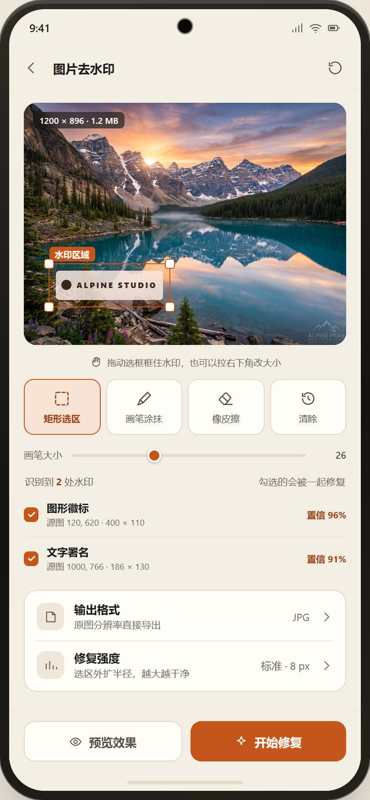
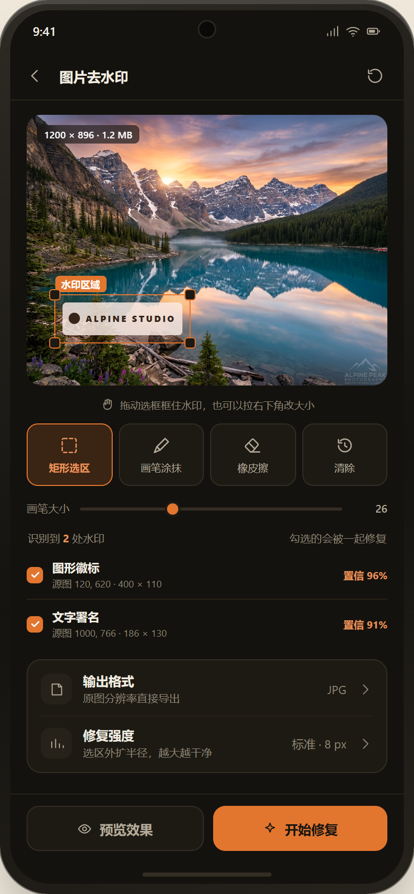
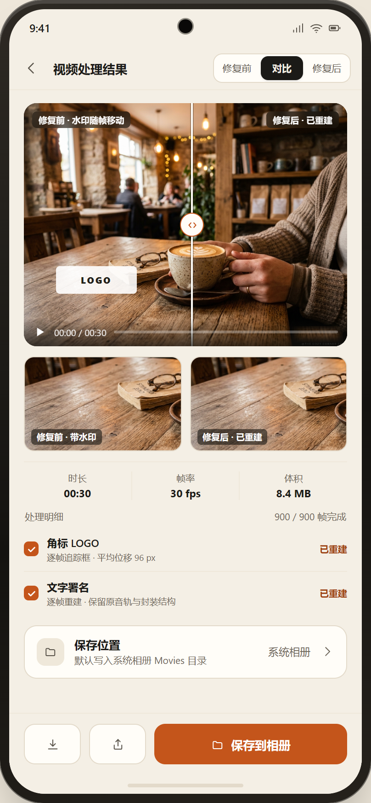
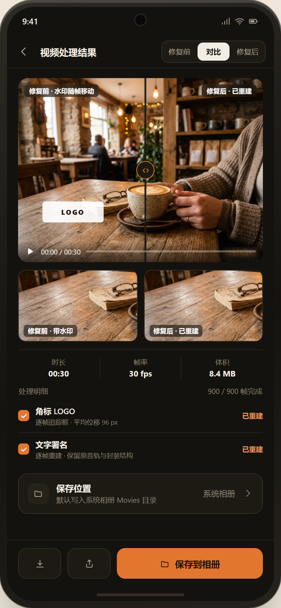

# 水印工坊（Watermark Remover）

**本地优先的图片 / 视频去水印 App —— 全程不联网，素材不出手机。**

Android 原生 + Flutter 实现：框选或涂抹水印区域，用 OpenCV 的 inpaint 算法在本机重绘，
图片一张、视频逐帧，修完可以直接存进相册。

- 当前版本：**v0.1.0**（Android 第一阶段）
- 包名：`cn.shuiyin.watermark_remover`
- 技术栈：Flutter 3.47.7 / Dart 3.13.5 · Riverpod · go_router · Kotlin · OpenCV 4.14
- 最低系统：Android 7.0（API 24）



---

## 一、它解决什么问题

手机上的水印（角落台标、日期、店铺 logo）想去掉，常规做法是把图传到某个在线工具上。
这类工具的问题是：**你的照片和视频离开了你的手机**，而且多数要付费才有原图。

水印工坊把这件事放回设备内完成：

1. **不上传**。没有账号、没有服务器，代码里不存在任何网络请求。
2. **不猜**。由你框出（或涂出）要去掉的那块，算法只重绘你指定的区域，其余像素不动。
3. **看得见结果**。图片给前后对比；视频给逐帧修复后的完整文件，可以就地全屏播一遍再决定存不存。

---

## 二、功能

### 图片去水印

- 从相册选图（Android 走系统 Photo Picker，**不申请读取整个相册的权限**）
- 三种选区工具：**矩形**、**画笔**（涂抹）、**橡皮**（擦掉多涂的部分）
- 选区支持拉角改大小；笔宽按图宽归一化，换个分辨率笔迹粗细一致
- OpenCV **TELEA** inpaint 重绘选区，结果与「修复前」做滑动分屏对比
- 一键保存进相册（`Pictures/水印工坊/`）

### 视频去水印

- 选视频后显示时长、分辨率、体积、是否有音轨、旋转角
- 框选水印区域后逐帧修复；**音频原样透传**（MediaExtractor → MediaMuxer，不重编码）
- **静止 / 跟随画面**两种模式：水印位置在动（手持拍摄、镜头平移）时打开「跟随画面」，
  用特征点匹配估计每帧的位移与缩放，把遮罩跟着画面一起移动
- 进度分成**两趟**：先「分析镜头运动」，再「逐帧修复」。两趟各自独立走 0→100%，
  不合成一个假的百分比
- 修完可以**全屏播放整段**（原生播放器，含声音与进度条），再决定保存
- 保存进相册（`Movies/水印工坊/`）

### 通用

- 历史记录：最近 50 条，带缩略图，可查看详情、可单条删除
- 深色 / 浅色 / 跟随系统，选择会持久化（杀进程重启后仍然保持）
- 全本地存储：任务与缩略图都在应用私有目录，清理缓存有安全边界

### 界面预览

| 浅色 | 深色 |
|---|---|
|  |  |
|  |  |

全部 8 屏：`ui/`（浅色）、`ui/深色/`（深色）、`ui/00-八屏总览.png`（一张看全）。
可交互的 HTML 原型：[`watermark-ui-prototype.html`](watermark-ui-prototype.html)。

---

## 三、安装包

`dist/` 目录里有编译好的 APK，直接下载装到手机上即可：

```
dist/watermark-remover-v0.1.0-arm64.apk    49 MB
```

- SHA-256：`3d6b01f2c733e7c2f70c5932484c41913b29957ccf7b87301468da7835d80acf`
- 构建于 2026-10-31，对应本仓库当前 `main` 分支的代码

> 也可以在仓库右侧 **Releases** 页面下载同样的包。

**装之前请先读这三行：**

1. **仅支持 64 位 ARM 设备**（arm64-v8a）。2019 年之后的绝大多数手机都是这个架构；
   32 位老机型会报 `INSTALL_FAILED_NO_MATCHING_ABIS`，需要自己按第五节的命令构建。
2. 这是**用 debug 签名**的测试包（`signingConfig = debug`），可以正常安装和使用，
   但**不适合上架应用商店**，也不能作为正式发行版分发。
3. 安装时系统可能提示「未知来源应用」，需要在设置里允许一次。

---

## 四、快速开始

### 环境要求

| 组件 | 版本 | 说明 |
|---|---|---|
| Flutter | **3.47.7**（stable） | Dart 3.13.5 |
| JDK | **17** | Android Gradle Plugin 要求 |
| Android SDK | compileSdk / targetSdk **36**，build-tools 36 | |
| Android NDK | **28.2.13676358（r28c）** | Flutter 构建必需 |
| 设备 | Android 7.0+ 真机或模拟器 | 只在 64 位 ARM 上验证过 |

### 跑起来

```bash
cd app
flutter pub get
flutter run                # 接上真机 / 模拟器
```

### 测试

```bash
cd app
dart analyze lib test integration_test   # 静态检查
flutter test                             # 单元 + Widget 测试（179 个用例）
flutter test integration_test            # 集成测试，需要一台连接的真机
```

> Windows 上如果配了代理，`flutter test` 之前先 `unset http_proxy https_proxy`，
> 否则本地测试服务的回环连接会被代理拦掉。

### 构建安装包

```bash
cd app
bash tool/build_release.sh      # 产物拷到 D:\dev\apk\watermark-remover-release.apk
```

**不要直接 `flutter build apk --release`。** 工程路径含中文时，release 走 AOT 编译，
`gen_snapshot` 按系统 ANSI 代码页读路径会变成 `D:\???\watermark`，直接失败。
`tool/build_release.sh` 的做法是把源码快照复制到一个纯 ASCII 路径再构建。
脚本里 `STAGE_DIR` / `OUT_DIR` 可以用环境变量改。

---

## 五、目录结构

```
watermark/
├── app/                          # Flutter 应用（真正的代码都在这里）
│   ├── lib/
│   │   ├── main.dart             # 入口，只做 runApp
│   │   ├── bootstrap.dart        # 全局错误钩子 + 启动
│   │   ├── app/                  # 应用外壳
│   │   │   ├── app.dart          # MaterialApp.router：主题 + 路由 + 本地化
│   │   │   ├── router/           # 路由表与 GoRouter（三个 Tab 各自独立栈）
│   │   │   └── widgets/app_shell.dart
│   │   ├── core/                 # 跨功能复用层
│   │   │   ├── theme/            # 设计令牌 AppTokens + 浅/深主题 + 主题开关
│   │   │   ├── widgets/          # 品牌组件：AppCard / AppButton / 前后对比 / 预览对话框
│   │   │   ├── media/            # 图片与视频探测、抽帧、原生通道封装
│   │   │   ├── processing/       # MaskPlan / WatermarkProcessor 抽象与错误码
│   │   │   ├── storage/          # 历史记录持久化、缓存目录、缩略图
│   │   │   ├── format/           # 时长/体积/时间等展示格式化
│   │   │   └── diagnostics/      # 构建期开关的调试探针
│   │   └── features/             # 按功能切分，每个都分 application/domain/presentation
│   │       ├── home/             # 首页：两个入口 + 最近处理
│   │       ├── image_editor/     # 图片去水印：选区 → 修复 → 对比 → 保存
│   │       ├── video_editor/     # 视频去水印：选区 → 两趟修复 → 预览 → 保存
│   │       ├── history/          # 历史列表与详情
│   │       └── profile/          # 我的：主题、缓存、关于
│   ├── android/
│   │   └── app/src/main/kotlin/cn/shuiyin/watermark_remover/
│   │       ├── MainActivity.kt   # 通道注册（含预览播放器插件）
│   │       └── media/            # 原生实现：探测、抽帧、逐帧修复、视频预览
│   ├── test/                     # 单元 + Widget 测试（18 个文件）
│   ├── integration_test/         # 真机集成测试（7 个场景）
│   ├── tool/                     # 构建与真机验收脚本
│   ├── assets/samples/           # 内置示例图/视频（编辑器里的「用示例」按钮）
│   └── README.md                 # 工程细节：选型理由、分层约定、实测数字
├── dist/                         # 发布用的 APK
├── ui/                           # 界面截图（浅色 / 深色）
├── assets/                       # 原型阶段的示例图（带 / 不带水印对照）
├── 技术方案/                     # 算法与架构设计文档
├── watermark-ui-prototype.html   # 可交互的 HTML 原型
└── README.md                     # 本文件
```

分层约定：`presentation` 只依赖 `application` 与 `core`，`domain` 不 import Flutter，
页面只用 `core/widgets/` 里的组件，颜色只从 `AppTokens.of(context)` 取。

---

## 六、技术栈与依赖

### Dart / Flutter

| 依赖 | 版本 | 用途 |
|---|---|---|
| Flutter / Dart | 3.47.7 / 3.13.5 | 框架 |
| `go_router` | 18.1.0 | 声明式路由，`StatefulShellRoute` 实现三个 Tab 各自独立导航栈 |
| `flutter_riverpod` | 3.4.3 | 状态管理（编译期安全、可 override 做测试替身、`AsyncValue` 贴合长任务） |
| `riverpod_annotation` | 4.0.7 | `@riverpod` 代码生成标注 |
| `image_picker` | 1.2.4 | 选图 / 选视频（走系统 Photo Picker，不申请全库权限） |
| `path_provider` | 2.1.6 | 临时目录与应用支持目录 |
| `package_info_plus` | 10.2.2 | 版本号（界面上显示，不写死） |
| `flutter_lints` | 6.0.0 | 静态检查基线（dev） |
| `riverpod_generator` / `build_runner` | 4.0.9 / 2.16.2 | 生成 `*.g.dart`（dev） |
| `image` | 4.12.0 | 生成历史缩略图、测试里造图（dev） |
| `integration_test` | SDK | 真机集成测试（dev） |

界面**不引第三方 UI kit**：用 Material 3 内置控件 + 自建 `core/widgets/`，
品牌样式集中在 `core/theme/app_tokens.dart` 一处。

### 原生（Kotlin / JVM）

| 依赖 | 版本 | 用途 |
|---|---|---|
| `org.opencv:opencv` | 4.14.0 | inpaint（TELEA）、遮罩运算、特征点匹配与相似变换估计 |
| `android.media.MediaExtractor / MediaCodec / MediaMuxer` | 系统 | 视频解码、逐帧处理、音频透传与重新封装 |
| `android.media.MediaPlayer` + `TextureRegistry` | 系统 | 修复结果的全屏预览（见下方说明） |

原生代码只通过 `MethodChannel`（`cn.shuiyin.watermark_remover/media`、
`.../video_preview`）对外暴露能力，Dart 侧拿到的是普通 Future，测试里可以整体 mock。

**为什么视频预览不用 `video_player`**：这台用于验证的华为机型上，`video_player`
内置的 ExoPlayer 会选中 `OMX.hisi.video.decoder.avc` 并 `Decoder init failed`，
而同一个文件我们自己用 `MediaCodec` 解码 150 帧零错误。`video_player` 不暴露
`MediaCodecSelector`，没法让它换解码器，于是改成自写的 `MediaPlayer` 插件 ——
走系统播放器同一条通路，音视频同步也由系统负责。

---

## 七、它是怎么工作的

**图片**：选区 → 生成二值遮罩 → `Imgproc.inpaint(..., INPAINT_TELEA)` → 输出 PNG。
遮罩用 `MaskPlan` 表达（矩形 / 路径），为将来接入学习型修复模型留好接口。

**视频**：

1. `MediaExtractor` 拆出视频轨与音频轨；
2. 视频轨送 `MediaCodec` 硬解，逐帧拿到 `Image`；
3. 对每帧按遮罩做 inpaint，再喂给编码器；
4. 音频轨**不解码**，直接复制样本写进 `MediaMuxer` —— 所以文件里听到的仍是原声；
5. 进度分两趟上报：第一趟统计帧数并估计镜头运动轨迹，第二趟逐帧修复。

「跟随画面」模式下，特征点在首帧与水印附近提取，后续帧做匹配，估计出位移 + 旋转 + 缩放
（相似变换）并累积成轨迹，遮罩按轨迹跟着走。轨迹有漂移时按关键帧重锚定。

耗时的大头是 inpaint：一次 150 帧、约 370×380 像素的修复，实测 inpaint 占 92%
（23.6s / 25.7s），解码与编码只是零头。

---

## 八、已知限制

- **只做了 Android**，第一阶段不含 iOS。
- **矩形选区过大**会连周围的干净背景一起模糊掉 —— 这是 inpaint 的固有特性，选区越小越自然。
- **跟随画面**适合平移/旋转/缩放的刚体运动；画面里有大面积遮挡或形变时轨迹会漂。
- 视频页目前只有**矩形**选区，逐帧手绘遮罩没有做。
- 修复结果和预览播放器都只在 64 位 ARM 真机上验证过。
- 「保存到相册」之外没有导出到指定目录的选项。

---

## 九、常见问题

**构建报 `Dart snapshot generator failed` / 路径里出现 `???`**
工程路径含中文，release 的 AOT 编译读不了。用 `app/tool/build_release.sh`。

**Gradle 卡在下载**
`gradle.properties` 里已经关掉了 daemon、并配了国内镜像；如果你换了网络环境，
检查 `app/android/settings.gradle.kts` 与 `~/.gradle/init.gradle` 的仓库地址。

**`flutter test` 卡住不动**
先 `unset http_proxy https_proxy`；另外别把输出管道给 `tail`（会把进度全缓冲住），
重定向到文件再 `tail` 文件。

**装了 APK 打不开 / 提示不兼容**
确认手机是 arm64 架构。若是 32 位老机，按第五节自己构建（改 `abiFilters`）。

---

## 十、文档索引

| 文档 | 内容 |
|---|---|
| [`app/README.md`](app/README.md) | 工程细节：选型理由、分层约定、每个模块的取舍、实测性能数字 |
| [`技术方案/`](技术方案/) | 算法与架构设计：遮罩计划、视频管线、错误码与降级策略 |
| [`watermark-ui-prototype.html`](watermark-ui-prototype.html) | 可交互原型（浏览器直接打开，含深色模式切换） |
| [`ui/`](ui/) | 8 屏浅色 / 深色截图 |

---

## 十一、版权与许可

本仓库**尚未声明开源许可**（默认保留所有权利）。如果要开源，建议补一份 LICENSE；
在此之前，代码仅供查看与学习，请勿直接用于商业分发。

内置示例素材（`app/assets/samples/`、`assets/`）仅用于演示功能：
其中示例视频为 CC0 素材，示例图片为公开图库素材。若你要二次分发，请自行确认素材授权。
